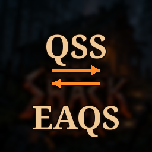

# QSS EAQS Bridge

**[Download on Thunderstore](https://thunderstore.io/c/valheim/p/TheShackDev/QSS_EAQS_Bridge/)** · version 1.1.1 · part of [The Shack Pack](https://thunderstore.io/c/valheim/p/TheShackDev/The_Shack_Pack/)

Makes **[Quick Stack - Store - Sort - Trash - Restock](https://thunderstore.io/c/valheim/p/Goldenrevolver/Quick_Stack_Store_Sort_Trash_Restock/)** (QSS) work properly with **[Equipment and Quick Slots](https://thunderstore.io/c/valheim/p/RandyKnapp/EquipmentAndQuickSlots/)** (EAQS) 3.x on Valheim 1.0.

## The problem

EAQS 3.x moved its armor and quick slots into real player-inventory cells, in three hidden rows below the visible grid. QSS 1.4.15 doesn't recognise them yet ([QuickStackStore#35](https://github.com/Goldenrevolver/QuickStackStore/issues/35)), so:

- **Sort** pulls your worn armor and quick-slot items into your bag.
- **Sort** can also place bag items into spare hidden cells, where you can't see them.

The current workaround is favoriting every armor and quick slot by hand on each character. This mod makes that unnecessary.

## What it does

Two small Harmony patches on QSS, using EAQS's public API (`EquipmentAndQuickSlots.API.IsSlotCell`):

1. QSS's equipment-slot check now recognises EAQS slots:
   - **Armor/equipment slots** are never sorted, quick stacked, stored or trashed.
   - **Quick slots** are left alone too, but can still be **restocked**, the same way QSS treats other quick-slot mods.
2. Sort fills the **visible inventory first**. EAQS's hidden rows go to the end of the list, so items are never hidden there. Items that were already stranded there come back into view on the next sort.

## Notes

- **Client-side only.** Sorting runs on the player's PC, so the server doesn't need it.
- Needs both QSS and EAQS. Without them it doesn't load.
- The patches only *add* protection. If QSS ships native EAQS support, this mod becomes a harmless no-op and can be removed.
- Tested with QSS 1.4.15, EAQS 3.1.3, BepInExPack 5.4.2351, Valheim 1.0.17.

## Credits

All credit for the actual features goes to Goldenrevolver (QSS) and RandyKnapp / MidnightsFX (EAQS). This is just glue between them.

## Building from source

You need the [.NET SDK](https://dotnet.microsoft.com/download) (6.0 or newer) and Valheim. The project compiles against your own copies of the game's DLLs and BepInEx; none of them are in this repo.

```bash
dotnet build -c Release \
  -p:ValheimManaged="/path/to/Valheim/valheim_Data/Managed" \
  -p:BepInExCore="/path/to/BepInEx/core"
```

`BepInExCore` is the `BepInEx/core` folder of any BepInEx install or r2modman profile. Without the `-p:` options the project looks for a Linux Steam install and an r2modman profile named "The Shack Next". The DLL lands in `bin/Release/`.

This is the source of version 1.1.1 on Thunderstore.

## License

MIT, see [LICENSE](LICENSE).

*This mod was written with the help of an AI assistant (Claude).*
